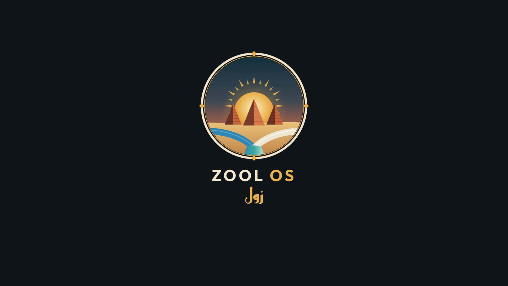
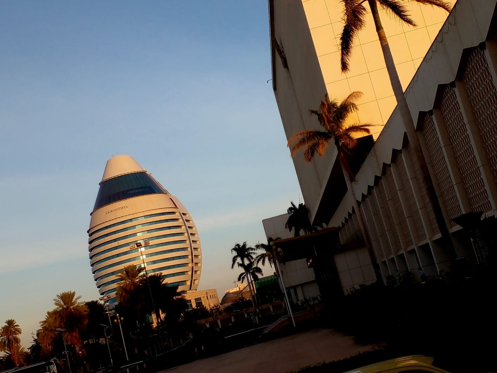

<div align="center">


# Zool OS — زول

**توزيعة لينكس سودانية خفيفة، مبنية على Arch Linux بسطح مكتب Hyprland**

[](https://github.com/imrnsec/zool-os-arch/releases/latest)




</div>

---

## لماذا «زول»؟

كلمة **«زول»** بالسودانية تعني «الشخص»، وهي أشهر كلمة تميّز السودانيين في أي مكان.
سُمّي النظام بها ليعرف أي زول يصادفه في أي مكان في العالم أنه نظام سوداني. 🇸🇩

الهوية البصرية مستوحاة من **أهرامات مروي** و**شمس السودان** و**التقاء النيلين** (الأزرق والأبيض) عند المقرن.

---

## المميزات

- 🪶 **خفيف:** ملف الـ ISO نحو **1.9GB** فقط.
- 🎨 **هوية سودانية متكاملة:** ثيم GRUB خاص بزول ثم شعار زول المتحرك، وشريط علوي عائم بألوان هادئة.
- 🌆 **ثيمان سودانيان حصريان** (`SUPER + T`) يغيّران الألوان والخلفية معاً:
  - **تراث** — أهرامات مروي والنيل، ألوان ليلية دافئة
  - **خرطوم** — برج الكورنثيا وليل الخرطوم، ألوان نهارية وليلية
- 🔐 **شاشة دخول احترافية:** واجهة مقسومة — صورة سودانية في اليسار، لوح دخول كريمي في اليمين، مع تاريخ ووقت وأزرار طاقة.
- 🕌 **أوقات الصلاة والتاريخ الهجري** في الشريط العلوي مع إشعار الأذان، تُحسب محلياً دون إنترنت (`zool-prayer`).
- 🔤 **خط عربي مريح للقراءة:** IBM Plex Sans Arabic للواجهة، وReem Kufi للعناوين، وAmiri للنصوص.
- ↔️ **عربي كامل من اليمين لليسار:** اختر العربية (`zool-language`) فتنقلب الواجهة والبرامج RTL.
- 🖥️ **Zool Terminal:** طرفية زول الخاصة (فوق محرّك VTE) — العربية فيها متصلة ومن اليمين، والأوامر الإنجليزية من اليسار، بألوان الثيم.
- 💿 **مثبّت رسومي بالعربية** (`zool-install`) ينقل النظام إلى القرص بخطوات بسيطة.
- 🧭 **قائمة زول الهرمية** (`SUPER + Z`) على نمط Omarchy: التطبيقات · المظهر · أدوات · الإعداد · تثبيت · تحديث.
- 📦 **تثبيت البرامج** (`zool-pkg-install` / `zool-pkg-aur-install`) ونسخة AUR عبر `yay`.
- 🔄 **تحديث بلا إعادة تثبيت** (`zool-update`): يجلب آخر مميزات زول من GitHub.
- 🔋 **للابتوب:** تنبيه البطارية، الضوء الليلي (`SUPER + N`)، وإيماءات لوحة اللمس.
- ⚡ **مهيّأ للأجهزة الضعيفة:** ذاكرة مضغوطة zram وفك ترميز الفيديو بالعتاد.
- 🌐 **تطبيقات الويب:** أضف أي موقع كتطبيق في القائمة.
- 🛡️ **جدار ناري مفعّل** بعد التثبيت.
- 🎬 **وسائط جاهزة:** ترميزات الفيديو والصوت، وقارئ PDF، وعارض صور، ومشغّل mpv.

---

## 🖼️ لقطات الشاشة

### شاشة الدخول — واجهة مقسومة
<div align="center">


</div>

<br>

> شاشة الدخول: الجهة اليسرى تعرض صورة الثيم الحالي، والجهة اليمنى لوح دخول بخلفية كريمية دافئة مع تحية «مرحباً بك يا زول» والوقت وأزرار الطاقة.

### ثيم تراث — Turath
<div align="center">


</div>

### ثيم خرطوم — Khartoum
<div align="center">


</div>

---

## 🎨 الواجهة

### الشريط العلوي — Waybar
شريط عائم نصف شفاف بثلاثة ألوان فقط:
- **رملي (sand):** كل وحدات الحالة (CPU، ذاكرة، صوت، شبكة، بطارية)
- **ذهبي (gold):** الشعار «زول» ومساحة العمل النشطة والصلاة القريبة
- **أحمر (red):** التحذيرات الحرجة فقط (انقطاع الشبكة، بطارية حرجة)

**محتوى الشريط:**
| اليسار | الوسط | اليمين |
|---|---|---|
| شعار «زول» · مساحات العمل · نوافذ مفتوحة | الوقت · التاريخ الهجري · وقت الصلاة | علبة النظام · لغة · CPU · RAM · صوت · شبكة · بطارية · طاقة |

### قائمة التطبيقات — Wofi
بطاقات شبكية (3 أعمدة) — الأيقونة فوق الاسم — تظهر الأيقونات بحجم 52×52 وتتلوّن عند التحديد بلون الذهبي من الثيم.

---

## 📥 التنزيل

1. افتح صفحة **[Releases](https://github.com/imrnsec/zool-os-arch/releases/latest)** ونزّل ملف `zoolos-….iso`.
2. تحقق من سلامة الملف (اختياري):
   ```bash
   sha256sum -c zoolos-*.iso.sha256
   ```

## 🔥 كتابة النظام على فلاشة

> ⚠️ **تنبيه:** هذه الخطوة تمسح كل ما على الفلاشة. تأكد من اسمها قبل البدء.

**من لينكس:**
```bash
lsblk                       # تعرّف على اسم الفلاشة، مثل /dev/sdX
sudo dd if=zoolos-*.iso of=/dev/sdX bs=4M status=progress oflag=sync
```

**من ويندوز:** استخدم [Rufus](https://rufus.ie) واختر وضع **DD Image** عند السؤال، أو [balenaEtcher](https://etcher.balena.io).

## 🚀 الإقلاع والتجربة

1. أعد تشغيل الجهاز واضغط مفتاح قائمة الإقلاع (غالباً `F12` أو `F9` أو `Esc`).
2. اختر الفلاشة. إن ظهر لها بندان فاختر الذي يحمل كلمة **UEFI** أو **EFI**.
3. في GRUB اختر **Zool OS** (أو خيار *safe graphics* إن ظهرت شاشة سوداء).
4. سيفتح النظام مباشرة (وضع حي) دون أن يغيّر شيئاً في جهازك.

## 💿 التثبيت على القرص

> ⚠️ **التثبيت يمسح القرص المختار بالكامل.** انسخ ملفاتك المهمة قبل أن تبدأ.

1. من النظام الحي اضغط **`SUPER + Z`** ثم اختر **تثبيت زول**.
2. اختر القرص الهدف، ثم أدخل اسم المستخدم واسم الجهاز وكلمة المرور والمنطقة الزمنية.
3. اختر هل تريد **الدخول التلقائي** (يوصى به إن واجهت مشكلة في شاشة الدخول).
4. أكّد، وانتظر انتهاء التثبيت، ثم أخرج الفلاشة وأعد التشغيل.

سجل التثبيت يُحفظ في `/tmp/zool-install.log` على النظام الحي.

---

## ⌨️ أهم الاختصارات

| الاختصار | الوظيفة |
|---|---|
| `SUPER + F1` | عرض كل الاختصارات |
| `SUPER + Z` | قائمة زول |
| `SUPER + Return` | طرفية زول |
| `SUPER + Space` | قائمة التطبيقات (Wofi) |
| `SUPER + B` / `SUPER + E` | المتصفح / مدير الملفات |
| `SUPER + W` / `ALT + F4` | إغلاق النافذة |
| `SUPER + T` | تغيير الثيم (تراث ↔ خرطوم) |
| `SUPER + N` | الضوء الليلي |
| `SUPER + L` | قفل الشاشة |
| `SUPER + Escape` | قائمة الطاقة |
| `Alt + Shift` | تبديل اللغة (EN ↔ عربي) |

---

## 💻 المتطلبات

- معالج 64-بت (x86_64).
- ذاكرة 2GB على الأقل، والأفضل 4GB.
- مساحة قرص 15GB فأكثر للتثبيت.
- يعمل بوضع **UEFI** و**BIOS (Legacy)**.

---

## 🗂️ هيكل المستودع

| المجلد | يُنسخ إلى | المحتوى |
|---|---|---|
| `bin/` | `/usr/local/bin` | أوامر زول (`zool-install`، `zool-prayer`، `zool-menu`…) |
| `config/` | `/etc/skel/.config` | إعدادات Hyprland وWaybar وWofi وMako |
| `etc/` | `/etc` | إعدادات النظام (الجلسة، systemd، mkinitcpio، Plymouth) |
| `share/` | `/usr/share` | الشعار والخلفيات والخطوط وثيم Plymouth |
| `themes/` | `/usr/share/zool/themes` | ثيمات زول (turath · khartoum) |
| `default/` | `/usr/share/zool/default` | الافتراضيات (ملف القائمة `menu.conf`) |
| `migrations/` | — | ترحيلات تُنفَّذ مرة عند `zool-update` |
| `iso/` | — | إعدادات الـ ISO: الحزم، GRUB، Syslinux |

---

## 🔄 التحديث

```bash
zool-update          # حزم النظام + آخر ملفات زول من GitHub
zool-update --zool   # ملفات زول فقط
zool-update check    # هل يوجد تحديث؟
```

## 🏗️ البناء من المصدر

```bash
sudo pacman -S --needed archiso git grub squashfs-tools libisoburn mtools dosfstools freetype2
git clone -b zool-os-arch https://github.com/imrnsec/zool-os-arch
cd zool-os-arch
bash build-zoolos.sh
```

ينتج الملف `zoolos-….iso` مع مجموعه `.sha256`. يلزم 12GB مساحة حرة. التفاصيل الكاملة في [`docs/BUILD.md`](docs/BUILD.md).

---

## 🛠️ ملاحظات معروفة

- **شاشة سوداء بعد التثبيت على بعض الأجهزة** (Intel Atom/Celeron القديم): اختر **الدخول التلقائي** أثناء التثبيت.
- المشروع ما زال في مرحلة مبكرة. أخبرنا بأي خطأ في [Issues](https://github.com/imrnsec/zool-os-arch/issues) مع صورة أو ملف السجل.

---

## 🤝 المساهمة

الأفكار والتصاميم والترجمات وإصلاحات الأخطاء كلها مرحّب بها. افتح Issue أو Pull Request.

## 📜 الترخيص

بنية المستودع وأدوات الحزم مستوحاة من [Omarchy](https://github.com/basecamp/omarchy) (MIT © David Heinemeier Hansson). الخطوط Amiri وReem Kufi تحت رخصة OFL.

---

## 📬 تواصل معي

<div align="center">

[](https://instagram.com/imrn.sec)
[](https://x.com/imrnsec)

</div>

---

<details>
<summary><b>English summary</b></summary>

**Zool OS** is a lightweight (~1.9 GB ISO) Sudanese-themed Linux distribution based on Arch Linux with the Hyprland Wayland compositor. "Zool" (زول) is Sudanese Arabic for "person" and is the most recognisable word of the Sudanese dialect.

**What's new in v0.2:**
- **Split-panel login screen** — left side shows the current theme's wallpaper, right side is a warm cream login panel with a fixed greeting "مرحباً بك يا زول", a live clock, and power buttons.
- **Simplified Waybar** — floating bar with only three colours: sand (all status modules), gold (logo, active workspace, upcoming prayer), red (critical alerts only). No colour noise.
- **Wofi card-grid** — app launcher shows icons above labels in a 3-column grid with 52×52 icon cards; selected card highlights in the theme's gold.
- **Two curated Sudanese themes** replacing the previous 13:
  - **Turath (تراث)** — Meroë pyramids, Nubian doors, felucca on the Nile; warm dark palette.
  - **Khartoum (خرطوم)** — Corinthia tower at sunset, Khartoum by day and night; modern palette.
- **Wallpaper scaling fixed** — `swaybg -m fill` correctly covers the screen without black borders.

**Features:** Arabic-first GUI installer, offline prayer times + Hijri date in Waybar with adhan notification, bundled Arabic fonts (Reem Kufi, Amiri, IBM Plex Sans Arabic), custom Zool GRUB theme and boot animation, an Omarchy-style hierarchical menu (`SUPER + Z`), fzf package pickers for Arch repos and the AUR (yay), in-place updates from GitHub (`zool-update`), media codecs, PDF/image viewers, and optional LibreOffice.

**Download:** grab the ISO from [Releases](https://github.com/imrnsec/zool-os-arch/releases/latest), write it with `dd` (Linux) or Rufus in DD mode (Windows), boot it in UEFI or BIOS mode, then press `SUPER + Z` → *Install Zool OS*. The installer erases the selected disk.

**Build:** see [`docs/BUILD.md`](docs/BUILD.md).

**Follow:** [Instagram @imrn.sec](https://instagram.com/imrn.sec) · [X @imrnsec](https://x.com/imrnsec)

</details>
