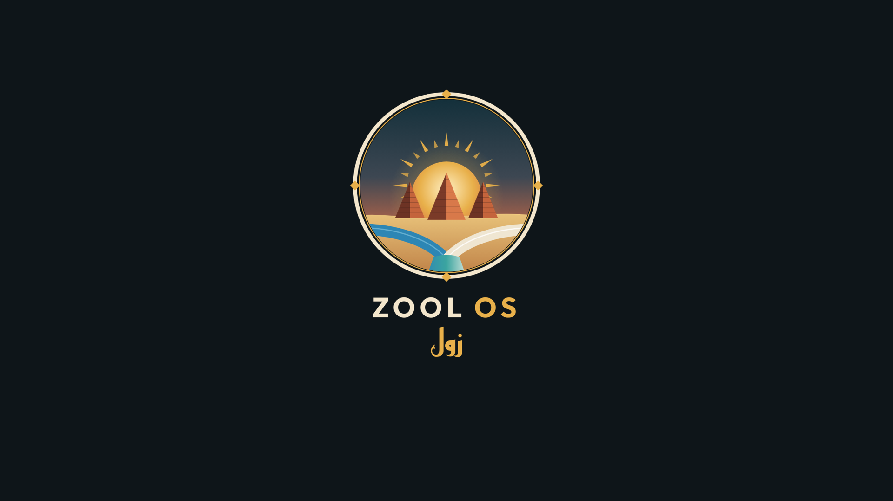

<div align="center">


# Zool OS — زول

**توزيعة لينكس سودانية خفيفة، مبنية على Arch Linux بسطح مكتب Hyprland**

[](https://github.com/imrnsec/snlnos/releases/latest)




</div>

---

## لماذا «زول»؟

كلمة **«زول»** بالسودانية تعني «الشخص»، وهي أشهر كلمة تميّز السودانيين في أي مكان.
سُمّي النظام بها ليعرف أي زول يصادفه في أي مكان في العالم أنه نظام سوداني. 🇸🇩

الهوية البصرية مستوحاة من **أهرامات مروي** و**شمس السودان** و**التقاء النيلين** (الأزرق والأبيض) عند المقرن.

## المميزات

- 🪶 **خفيف:** ملف الـ ISO نحو **1.9GB** فقط.
- 🎨 **هوية سودانية متكاملة:** ثيم GRUB (YoRHa) ثم شعار زول المتحرك، وثلاث خلفيات سودانية (غروب النيل · ليل مروي · فجر الكثبان).
- 🕌 **أوقات الصلاة والتاريخ الهجري** في الشريط العلوي مع إشعار الأذان، وتُحسب محلياً دون إنترنت (`zool-prayer`).
- 🔤 **خطوط عربية مضمّنة:** Reem Kufi للعناوين وAmiri للنصوص إلى جانب Noto.
- 💿 **مثبّت رسومي بالعربية** (`zool-install`) ينقل النظام بثيماته إلى القرص بخطوات بسيطة.
- 🔐 **شاشة دخول SDDM** بهوية زول.
- 🪟 **Hyprland** مع شريط Waybar وقائمة Wofi وإشعارات Mako بألوان رمل السودان ونيله.
- ⌨️ **مساحات عمل بأرقام عربية**، وتبديل لوحة المفاتيح بين الإنجليزية والعربية بـ `Alt+Shift`.
- 🎬 **وسائط جاهزة:** ترميزات الفيديو والصوت، وقارئ PDF (evince)، وعارض صور (loupe)، ومشغّل (mpv).
- 📦 **برامج اختيارية:** LibreOffice وغيره بضغطة من قائمة `zool-extras`.

<div align="center">


</div>

---

## 📥 التنزيل

1. افتح صفحة **[Releases](https://github.com/imrnsec/snlnos/releases/latest)** ونزّل ملف `zoolos-….iso`.
2. نزّل معه ملف `.sha256` إن أردت التحقق من سلامة الملف:
   ```bash
   sha256sum -c zoolos-*.iso.sha256
   ```

## 🔥 كتابة النظام على فلاشة

> ⚠️ **تنبيه:** هذه الخطوة تمسح كل ما على الفلاشة. تأكد من اسمها قبل البدء.

**من لينكس:**
```bash
lsblk                       # تعرّف على اسم الفلاشة، مثل /dev/sdX
sudo dd if=zoolos-*.iso of=/dev/sdX bs=4M status=progress oflag=sync
```

**من ويندوز:** استخدم [Rufus](https://rufus.ie) واختر وضع **DD Image** عند السؤال، أو [balenaEtcher](https://etcher.balena.io).

## 🚀 الإقلاع والتجربة

1. أعد تشغيل الجهاز واضغط مفتاح قائمة الإقلاع (غالباً `F12` أو `F9` أو `Esc`).
2. اختر الفلاشة. إن ظهر لها بندان فاختر الذي يحمل كلمة **UEFI** أو **EFI** (إن كان جهازك يدعمه).
3. في GRUB اختر **Zool OS** (أو خيار *safe graphics* إن ظهرت شاشة سوداء).
4. سيفتح النظام مباشرة (وضع حي) دون أن يغيّر شيئاً في جهازك.

## 💿 التثبيت على القرص

> ⚠️ **التثبيت يمسح القرص المختار بالكامل.** انسخ ملفاتك المهمة قبل أن تبدأ.

1. من النظام الحي اضغط **`SUPER + Z`** ثم اختر **تثبيت زول**.
2. اختر القرص الهدف، ثم أدخل اسم المستخدم واسم الجهاز وكلمة المرور والمنطقة الزمنية.
3. اختر هل تريد **الدخول التلقائي** (يوصى به إن واجهت مشكلة في شاشة الدخول).
4. أكّد، وانتظر انتهاء التثبيت، ثم أخرج الفلاشة وأعد التشغيل.

سجل التثبيت يُحفظ في `/tmp/zool-install.log` على النظام الحي، وهو مفيد عند الإبلاغ عن مشكلة.

## ⌨️ أهم الاختصارات

| الاختصار | الوظيفة |
|---|---|
| `SUPER + F1` | عرض كل الاختصارات |
| `SUPER + Z` | قائمة زول (التثبيت، مدينة الصلاة، البرامج الإضافية…) |
| `SUPER + Return` | الطرفية (kitty) |
| `SUPER + Space` | قائمة التطبيقات |
| `SUPER + B` / `SUPER + E` | المتصفح / مدير الملفات |
| `SUPER + L` | قفل الشاشة |
| `SUPER + Escape` | قائمة الطاقة |
| `Alt + Shift` | تبديل اللغة (EN ↔ عربي) |

## 💻 المتطلبات

- معالج 64-بت (x86_64).
- ذاكرة 2GB على الأقل، والأفضل 4GB.
- مساحة قرص 15GB فأكثر للتثبيت.
- يعمل بوضع **UEFI** و**BIOS (Legacy)**.

## 🛠️ ملاحظات معروفة

- **شاشة سوداء بعد التثبيت على بعض الأجهزة** (جرّبناه على معالج Intel Atom/Celeron القديم): اختر **الدخول التلقائي** أثناء التثبيت.
- المشروع ما زال في مرحلة مبكرة، وقد تجد أخطاء. أخبرنا عنها في [Issues](https://github.com/imrnsec/snlnos/issues) مع صورة للخطأ أو ملف السجل.

## 🏗️ البناء من المصدر

```bash
sudo pacman -S --needed archiso git grub squashfs-tools libisoburn mtools dosfstools
git clone -b zool-os-arch https://github.com/imrnsec/snlnos
cd snlnos
bash build-zoolos.sh
```

يلزم 12GB مساحة حرة على الأقل. التفاصيل الكاملة (بما فيها البناء داخل Docker من أي توزيعة) في [`docs/BUILD.md`](docs/BUILD.md).

## 🤝 المساهمة

الأفكار والتصاميم والترجمات وإصلاحات الأخطاء كلها مرحّب بها. افتح Issue أو Pull Request.

## 📜 الترخيص

ثيم GRUB (YoRHa) من تأليف OliveThePuffin ويُنزَّل وقت البناء. الخطوط Amiri وReem Kufi تحت رخصة OFL ونصوصها مرفقة في مجلد الخطوط.

---

<details>
<summary><b>English summary</b></summary>

**Zool OS** is a lightweight (~1.9 GB ISO) Sudanese-themed Linux distribution based on Arch Linux with the Hyprland Wayland compositor. "Zool" (زول) is Sudanese Arabic for "person" and is the most recognisable word of the Sudanese dialect.

**Features:** Arabic-first GUI installer, offline prayer times + Hijri date in Waybar with adhan notification, bundled Arabic fonts (Reem Kufi, Amiri, Noto), SDDM login theme, YoRHa GRUB theme with a Zool boot animation, media codecs, PDF/image viewers, and optional LibreOffice.

**Download:** grab the ISO from [Releases](https://github.com/imrnsec/snlnos/releases/latest), write it with `dd` (Linux) or Rufus in DD mode (Windows), boot it in UEFI or BIOS mode, then press `SUPER + Z` → *Install Zool OS*. The installer erases the selected disk.

**Build:** see [`docs/BUILD.md`](docs/BUILD.md).

</details>
